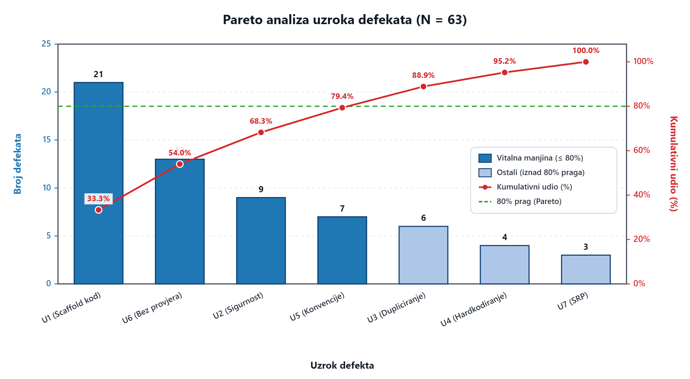
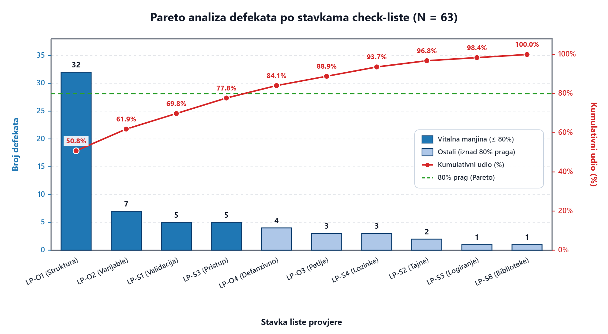

# Izvještaj o inspekciji koda i Pareto analiza

## 1. Osnovni podaci o inspekciji

* **Aplikacija:** `eVrticSistem` 
* **Pull Request:** `#1` (`VVS-2026-2027/Grupa4-Tim3`)
* **Ukupno pronađenih grešaka:** 63 jedinstvena defekta (od ukupno 66 kreiranih issue kartica, jer su `#26`, `#33` i `#70` bili duplikati)
* **Korištene liste provjere:** Opšta lista provjere (`LP-O1` – `LP-O4`, Predavanje 2) i sigurnosna lista provjere (`LP-S1` – `LP-S8`, Predavanje 3)

Pregled pronađenih grešaka po članovima tima:

| Inspektor | Broj pronađenih defekata | Procenat (%) |
| :--- | :---: | :---: |
| Omer Masleša | 25 | 39,68% |
| Hamza Jašarević | 11 | 17,46% |
| Tarik Beganović | 11 | 17,46% |
| Kerim Mujkanović | 9 | 14,29% |
| Damir Muharem | 7 | 11,11% |
| **Ukupno** | **63** | **100,00%** |

---

## 2. Pareto analiza uzroka grešaka

Pronađene greške smo grupisali prema uzrocima (`U1`–`U7`) i poredali od najčešćeg ka najrjeđem:

| Rang | Uzrok | Broj grešaka | Procenat (%) | Kumulativno (%) |
| :---: | :--- | :---: | :---: | :---: |
| 1 | **U1** – Generisani (scaffold) kod koji nije dorađen ni očišćen | 21 | 33,33% | 33,33% |
| 2 | **U6** – Nedostatak provjera i validacije | 13 | 20,63% | 53,97% |
| 3 | **U2** – Nepoznavanje sigurnosnih praksi | 9 | 14,29% | 68,25% |
| 4 | **U5** – Nepoštovanje konvencija pisanja i organizacije koda | 7 | 11,11% | 79,37% |
| 5 | **U3** – Kopiranje i dupliciranje koda | 6 | 9,52% | 88,89% |
| 6 | **U4** – Hardkodiranje podataka i stringova | 4 | 6,35% | 95,24% |
| 7 | **U7** – Previše odgovornosti u jednoj klasi/metodi | 3 | 4,76% | 100,00% |
| | **Ukupno** | **63** | **100,00%** | — |

### Zaključak za uzroke (80/20 pravilo)
Prva četiri uzroka (**U1**, **U6**, **U2** i **U5**) zajedno čine **50 od 63 greške**, što je **79,37%** svih problema u kodu. Najveći problem je automatski generisani (scaffold) CRUD kod (**U1** – 33,33%), gdje su autori na početak GET metoda samo dodali `return Forbid()`, ostavljajući ostatak metode kao mrtav kod, dok su POST metode poput `DeleteConfirmed` ostale otključane. Drugi najčešći uzrok je nedostatak serverskih provjera i validacije ulaza (**U6** – 20,63%).

---

## 3. Pareto analiza defekata po stavkama check-liste

Defekti su raspoređeni prema stavkama opšte (`LP-O*`) i sigurnosne (`LP-S*`) liste provjere:

| Rang | Stavka check-liste | Broj grešaka | Procenat (%) | Kumulativno (%) |
| :---: | :--- | :---: | :---: | :---: |
| 1 | **LP-O1** – Struktura | 32 | 50,79% | 50,79% |
| 2 | **LP-O2** – Varijable i aritmetika | 7 | 11,11% | 61,90% |
| 3 | **LP-S1** – Validacija unosa | 5 | 7,94% | 69,84% |
| 4 | **LP-S3** – Kontrola pristupa | 5 | 7,94% | 77,78% |
| 5 | **LP-O4** – Defanzivno programiranje | 4 | 6,35% | 84,13% |
| 6 | **LP-O3** – Petlje i grananja | 3 | 4,76% | 88,89% |
| 7 | **LP-S4** – Lozinke i zaštita podataka | 3 | 4,76% | 93,65% |
| 8 | **LP-S2** – Tajne u kodu | 2 | 3,17% | 96,83% |
| 9 | **LP-S5** – Greške i logiranje | 1 | 1,59% | 98,41% |
| 10 | **LP-S8** – Zastarjele biblioteke | 1 | 1,59% | 100,00% |
| | **Ukupno** | **63** | **100,00%** | — |

### Zaključak za defekte
Polovina svih pronađenih grešaka spada u kategoriju **LP-O1 – Struktura** (50,79%), uglavnom zbog nedostižnog koda nakon `Forbid()`, nekorištenih metoda i ponavljanja iste logike u više akcija. Prve četiri stavke (**LP-O1**, **LP-O2**, **LP-S1** i **LP-S3**) obuhvataju **77,78%** svih grešaka, a sa stavkom **LP-O4** prelaze granicu od 80% (**84,13%**). Od ukupnog broja grešaka, **17 defekata (26,98%)** odnosi se na sigurnosne propuste (`LP-S*`).

---

## 4. Pregled po ozbiljnosti grešaka

| Ozbiljnost | Broj grešaka | Procenat (%) | Primjeri pronađenih grešaka |
| :--- | :---: | :---: | :--- |
| **5 – Kritično** | 4 | 6,35% | Hardkodirana admin lozinka u `Program.cs` (`#3`), brisanje bolesti, izvještaja i sažetaka bez autorizacije (`#60`, `#7`, `#2`) |
| **4 – Visoko** | 8 | 12,70% | Otkrivanje emaila preko `userId` parametra (`#67`), pristup tuđim obavijestima (`#36`), slaba pravila za lozinke (`#5`), direktno vezivanje entiteta (`#42`) |
| **3 – Srednje** | 21 | 33,33% | Neobrađeni izuzeci pri dekodiranju tokena i pozivu `.Trim()` (`#69`, `#68`), brisanje korisnika bez transakcije (`#12`), nezaštićeni zdravstveni podaci (`#11`) |
| **2 – Nisko** | 23 | 36,51% | Duplicirani HTML i metode (`#71`, `#46`, `#6`), hardkodirani nazivi uloga (`#47`, `#38`), starija verzija `jquery-validation` (`#23`) |
| **1 – Minorno** | 7 | 11,11% | Nekorištene pomoćne metode (`#63`), greške u imenovanju klasa (`#40`), višak zareza u CSS-u (`#25`) |
| **Ukupno** | **63** | **100,00%** | — |

---

## 5. Prijedlog za ispravku

1. **Sigurnosni propusti (ozbiljnost 5 i 4):** Izbaciti hardkodirane kredencijale iz `Program.cs` i isključiti `appsettings.json` iz Docker image-a (`#3`, `#22`), dodati `[Authorize]` i provjeru uloga/vlasništva na sve kontrolere i akcije za brisanje (`#2`, `#7`, `#36`, `#60`, `#67`), te pojačati pravila za lozinke i uključiti lockout (`#5`).
2. **Čišćenje koda:** Obrisati neiskorištene scaffold akcije koje samo vraćaju `Forbid()` i mrtvi kod iza njih u svim kontrolerima.
3. **Validacija i provjere:** Dodati validacijske atribute (`DataAnnotations`) na modele, provjeravati `ModelState.IsValid` i `null` vrijednosti prije obrade unosa, te koristiti transakcije kod brisanja povezanih podataka u bazi.